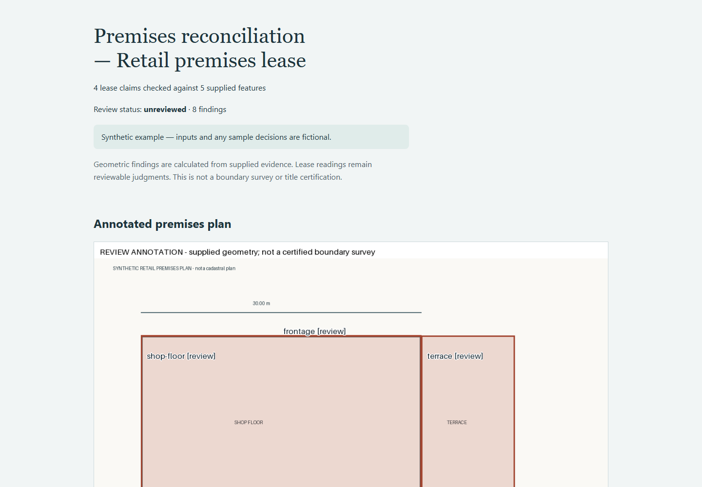

# lease-plan-check

[](https://github.com/kevanwee/lease-plan-check/actions/workflows/ci.yml)

**Reconcile lease claims against supplied, calibrated premises geometry.** A standalone CLI and offline evidence-review workspace for property lawyers, survey-support teams and facilities reviewers.



## A complete sample matter

A synthetic retail plan has a 600 m² shop floor against a stated 650 m², an excluded 200 m² terrace said to be included, 30 m frontage against 31 m and an obstructed service route.

The primary outputs are `annotated-plan.png`, `measurements.json`, `geometry.local.json`, the source-linked reports and `review.html`. The plan is embedded in the offline review.

## Install and run

Requires Python 3.11 or later. Clone this repository and work from its root:

```bash
git clone https://github.com/kevanwee/lease-plan-check.git
cd lease-plan-check
python -m venv .venv
```

Activate with `source .venv/bin/activate` on macOS/Linux or
`.venv\Scripts\Activate.ps1` in PowerShell, then:

```bash
python -m pip install .
python -m lease_plan_check check examples/retail-premises/matter.json --out out/change
python -m lease_plan_check verify out/change
```

Open `out/change/review.html` in your browser. The CLI and review run offline after
installation. No model API key, account, server or sibling project is required.
Samples describe fictional future drafts and plans; they make no claim of actual
execution, legal effectiveness or current law. See [sample licensing](examples/NOTICE.md).

## Complete the review

1. Inspect every finding, its classification, before/after values and source evidence.
2. Confirm, dismiss, correct the assessment, or record that more information is needed.
   Add a reason for every decision. A correction is an explicit reviewer overlay;
   original observations and source files stay intact.
3. Enter the reviewer's name/role, basis and authority. Download `review-decisions.json`.
   Names are supplied attestations, not authenticated identity or decision rights.
4. Place the downloaded decision in the repository root, then run:

```bash
python -m lease_plan_check finalize out/change --decisions review-decisions.json --out out/reviewed
python -m lease_plan_check verify out/reviewed
```

The final directory contains `report.html`, reviewed JSON/Markdown/SARIF, decisions,
source snapshots and a receipt hashing the exported files. Pending questions retain
`needs-information` status. Even a completed review can confirm unresolved substantive
problems; review completion does not mean compliance, a cleared licence or a correct
lease. No external system is changed.

Reports include configuration, the CI threshold, runtime versions, source hashes, source locators, scope assumptions and
review status. Package fingerprints bind decisions to the exact saved analysis. An
edited source, configuration or extraction requires a new analysis and new decisions.
Old output directories are never overwritten. The review renderer is versioned with
the engine; retain the same engine version when verifying old packages.

## Error and CI behaviour

Exit **0** means the requested analysis/export succeeded; it is not a legal clearance.
Use `--fail-on info`, `--fail-on warning` or `--fail-on error` for an explicit CI gate.
Exit **1** means findings reached that threshold; the report is still exported.
Exit **2** means invalid inputs or a refused operation, including stale/incomplete
decisions. Argument-parser errors also return 2. Default `--fail-on none` permits
interactive exploration without treating findings as an execution failure.

Unknown keys and schema versions are refused. JSON duplicate keys and non-finite
numbers are refused. A failed build publishes no partial matter directory. No-op
comparisons still produce an inspectable report; no findings does not establish legal
adequacy. Hashes detect accidental alteration, not malicious rewriting of all hashes
or independent source authenticity.

Keep original analysis packages alongside reviewed exports. These files can contain
confidential matter data. This repository's `.gitignore` excludes `out/`; choose local
storage consistent with your organisation's requirements. No data is uploaded by the tool.

## Development and verification

```bash
python -m pip install -e ".[dev]"
python -m pytest
python -m ruff check src tests
python -m pip wheel . --no-deps --wheel-dir dist
```

Versioned schemas are in `schema/`; `python -m lease_plan_check schema NAME` prints them.
CI runs Python 3.11/3.14 on Linux and Windows. Tests cover deterministic domain logic,
the complete analysis/review/export journey, invalid inputs, tampering, correction
overlays and preserved originals. See [acceptance evidence](docs/ACCEPTANCE.md) and
[the walkthrough](docs/SOP.md).

## Licence

MIT. The synthetic sample data and plan artwork are also MIT-licensed. Dependency
licences remain with their respective projects. No real client documents are included.

## Scope and method

Version one accepts one PNG plan, inspected UTF-8 lease text and an explicit JSON
matter. A human supplies control points, digitised polygons/lines and quoted lease
claims. It does not infer premises boundaries from pixels or automatically read plans.

An affine least-squares transform maps pixel coordinates into **local engineering
metres**. At least three non-collinear controls are required; additional controls
provide fit residuals. Three-control fits are specifically flagged. Residuals describe
agreement between supplied controls, not independent survey accuracy.

Supported claims: polygon area, labelled-line length, polygon inclusion/exclusion and
whether a buffered access route intersects a supplied obstacle. Inclusion reports the
area of the second polygon lying outside the first. Exclusion/access report overlap
area. Tolerances are absolute m² for areas/overlaps and metres for line lengths.
They are review configuration, not prescribed legal tolerances.

The geometry export contains WKT and an explicit local-metres coordinate-space
declaration. It is intentionally not geographic GeoJSON: no WGS84, EPSG code, ground
location or cadastral accuracy is invented. Version one handles simple polygons and
lines; polygon holes, curves, multi-floor registration and geographic reprojection
are outside scope.

Only enumerated lease claims are checked. The result is neither a boundary survey
nor a title, area or access-right certification. A numerical match does not establish
that the supplied geometry represents the legally demised premises.

## Correcting source facts

Inspect the annotated plan and calibration records. Correct controls, vertices, quoted lease readings or tolerances in matter.json and regenerate into a new directory. Update source hashes only after inspecting changed source documents. Assessment corrections in the review page remain separate from original measurements.

## Invalid and contradictory inputs

Changed source hashes, external asset paths, missing features, duplicate IDs, unsupported units/claim combinations, non-finite coordinates, collinear/collapsed/contradictory calibration, out-of-image features and invalid/self-intersecting geometry are refused. No automatic geometry repair changes evidence.


## Optional browser regression

Install the developer browser tool locally:

```bash
npm install --prefix out/browser-tools playwright
npx --prefix out/browser-tools playwright install chromium
node scripts/verify_browser.mjs
```

The script uses your active `python` by default (`PROJECT_PYTHON` can select another).
It runs a synthetic analysis, desktop/mobile checks, an incomplete-review refusal,
downloads a synthetic corrected decision, finalizes it and verifies the exported report.
It creates a fresh namespace under `out/` and refreshes the README screenshot.
For a standalone distribution check, build a wheel and run `scripts/smoke_wheel.py
--wheel PATH_TO_WHEEL`. That test creates a clean environment outside the source tree.
