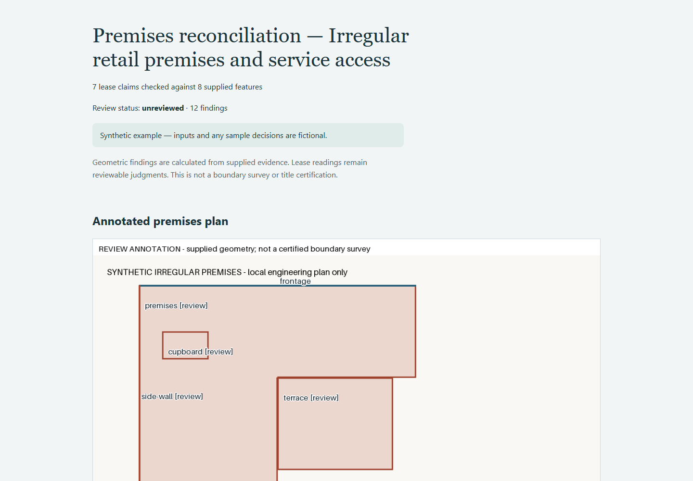

# Complex matter verification — 0.1.1

All inputs, parties, systems, plans and sign-offs in this rehearsal are synthetic.
Expected-result ledgers are authored independently of engine output and stored in
`examples/irregular-premises/expected.json`. They test calculations and recorded comparisons;
they do not provide independent legal or survey validation.

## Subject matter and results

The case combines an L-shaped premises polygon, a terrace, an excluded cupboard,
two measured lines, two access routes and an obstruction: 8 features and 7 claims.
Six controls define a rotated/sheared affine transform rather than a simple scale.

Independent calculations: the L shape is 600×200 + 300×300 = 210000 pixel².
The transform determinant has magnitude .0022 m²/pixel², so premises area is 462 m²
against a stated 465 m². Terrace area outside the premises is 110 m²; cupboard overlap
is 13.2 m². Frontage is sqrt(30²+12²) = 32.31098884 m, matching 32.31 within .01 m.
The side length is sqrt(5²+20²) = 20.61552813 m against 21 m. One buffered route intersects
the obstacle; the alternative does not. Exactly five discrepancies and two matches result.

The run produces 12 findings: five geometric discrepancies and seven proposed lease
readings. The synthetic review leaves those seven readings pending; calculated values
do not independently establish which geometry the lease legally demises.

Stress testing found that 0.1.0 accepted boolean measurements/tolerances as numbers.
Version 0.1.1 refuses boolean stated areas, claim tolerances, route widths and calibration
tolerances. Contradictory controls, bow-tie geometry and unsupported polygon-hole input
are explicitly refused. Local engineering coordinates remain distinct from geographic
or registered cadastral coordinates.



## Reproduce the complete journey

Install from the README, then run from the repository root:

```bash
python scripts/rehearse_complex.py --out out/complex-rehearsal
```

This synthetic-only command analyses the matter, freezes the evidence, records labelled
synthetic decisions, exports a reviewed report and verifies it. It deliberately leaves
unresolved questions pending. Open `out/complex-rehearsal/analysis/review.html` to make
your own review; save new decisions and finalize into a separate fresh directory.
The output `rehearsal.json` records finding/pending counts and states that no external
action or legal clearance has been established. Existing outputs are never overwritten.

For the actual browser regression, install Playwright as described in the README and
set `BROWSER_SCENARIO=scripts/complex-scenario.json` before running
`node scripts/verify_browser.mjs`. In PowerShell use
`$env:BROWSER_SCENARIO='scripts/complex-scenario.json'` first. It tests desktop/mobile,
filtering, incomplete-review refusal, correction overlays, decision download, final
export and pending-status preservation.

## Product status

47 local unit/end-to-end tests pass. The browser journey passes with no page errors
or horizontal mobile overflow. Full-suite and clean-wheel checks also run in CI.
See [the execution record](complex-verification.json) and the repository's Actions tab.

This is evidence that the bounded workflow executes on harder cases. It is not evidence
that the product can resolve arbitrary subject matter or replace responsible review.
